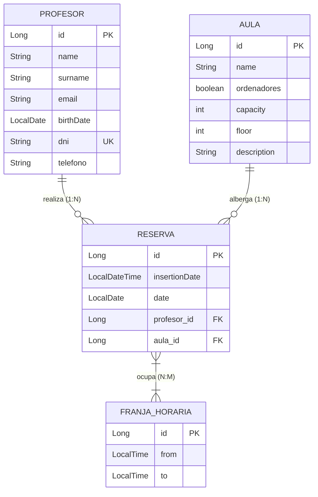

# Sistema de Gestión de Reservas de Aulas

[](https://www.oracle.com/java/)
[](https://spring.io/projects/spring-boot)
[](https://mariadb.org/)
[](https://projectlombok.org/)

Proyecto desarrollado para el módulo de **Acceso a Datos** del 2.º curso del Ciclo Formativo de Grado Superior en **Desarrollo de Aplicaciones Multiplataforma (DAM)**.

---

## 📌 1. Descripción del Proyecto

El sistema es una **API RESTful** construida con **Spring Boot**, **Spring Data JPA (Hibernate)**, **MariaDB** y **Lombok**, orientada a gestionar la ocupación, disponibilidad y reserva de espacios en un centro educativo.

Permite administrar:
- **Profesores:** Docentes autorizados para reservar aulas y recursos.
- **Aulas:** Espacios físicos con atributos como capacidad, planta y dotación de ordenadores.
- **Franjas Horarias:** Intervalos de tiempo lectivo (`hora inicio` y `hora fin`) configurables.
- **Reservas:** Asignaciones que vinculan un profesor, un aula, una fecha específica y una o varias franjas horarias, garantizando que no existan conflictos ni solapamientos.
- **Frontend (en desarrollo):** Interfaz web ligera construida exclusivamente con **HTML5, CSS3 y JavaScript vanilla** (sin frameworks externos) alojada en `/frontend`.

---

## 🏗️ 2. Arquitectura y Modelo de Datos

El diseño de la base de datos se basa en el modelo entidad-relación definido para el centro educativo:



*Nota: El diagrama conceptual original se encuentra disponible en [BBDD.png](file:///run/media/aitorgallegoo_cr/CORSAIR%201TB/Formaci%C3%B3n/Grado%20Superior%20Desarrollo%20de%20Aplicaciones%20Multiplataforma/2%C2%BA%20A%C3%B1o/PDAU/UT1/Practicas/GestionReservas/BBDD.png).*

---

## 📁 3. Estructura del Repositorio

```text
GestionReservas/
├── pom.xml                                      # Configuración Maven y dependencias
├── HELP.md                                      # Guía genérica generada por Spring Initializr
├── README.md                                    # Documentación principal del proyecto
├── DOC.md                                       # Bitácora de desarrollo con IA, prompts, errores y decisiones
├── AGENTS.md                                    # Contexto técnico, directrices y reglas para agentes de IA
├── Enunciado.odt                                # Enunciado oficial de la práctica (Tarea 1)
├── BBDD.png                                     # Diagrama E/R conceptual de la base de datos
├── src/
│   ├── main/
│   │   ├── java/com/juanbosco/gestionreservas/
│   │   │   ├── GestionReservasApplication.java  # Clase principal de arranque Spring Boot
│   │   │   ├── CorsConfig.java                  # Configuración global de CORS para consumo API
│   │   │   ├── entity/
│   │   │   │   ├── Profesor.java                # Entidad JPA: Docente
│   │   │   │   ├── Aula.java                    # Entidad JPA: Aula/Espacio
│   │   │   │   ├── FranjaHoraria.java           # Entidad JPA: Turnos y horas lectivas
│   │   │   │   └── Reserva.java                 # Entidad JPA: Asignación de reserva
│   │   │   ├── repository/
│   │   │   │   ├── ProfesorRepository.java      # Interfaz JpaRepository para Profesor
│   │   │   │   ├── AulaRepository.java          # Interfaz JpaRepository para Aula
│   │   │   │   ├── FranjaHorariaRepository.java # Interfaz JpaRepository para FranjaHoraria
│   │   │   │   └── ReservaRepository.java        # Interfaz JpaRepository para Reserva
│   │   │   └── controller/
│   │   │       └── ProfesorController.java      # Controlador REST para gestión de profesores
│   │   └── resources/
│   │       └── application.properties           # Parámetros de conexión a MariaDB e Hibernate
│   └── test/
│       └── java/com/juanbosco/gestionreservas/
│           └── GestionReservasApplicationTests.java # Tests de contexto Spring Boot
```

---

## ⚙️ 4. Requisitos y Configuración Local

### Prerrequisitos
- **Java Development Kit (JDK):** Versión 21 o superior (configurado para Java 25 en `pom.xml`).
- **Gestor de Base de Datos:** MariaDB o MySQL Server en ejecución en el puerto `3306`.
- **Maven:** No es necesario tenerlo instalado; se incluye el wrapper `./mvnw`.

### Configuración de la Base de Datos
1. Iniciar el servicio MariaDB / MySQL.
2. Crear la base de datos y usuario correspondientes (según [application.properties](file:///run/media/aitorgallegoo_cr/CORSAIR%201TB/Formaci%C3%B3n/Grado%20Superior%20Desarrollo%20de%20Aplicaciones%20Multiplataforma/2%C2%BA%20A%C3%B1o/PDAU/UT1/Practicas/GestionReservas/src/main/resources/application.properties)):
   ```sql
   CREATE DATABASE IF NOT EXISTS app_db CHARACTER SET utf8mb4 COLLATE utf8mb4_unicode_ci;
   CREATE USER IF NOT EXISTS 'aitor'@'localhost' IDENTIFIED BY 'aitor123';
   GRANT ALL PRIVILEGES ON app_db.* TO 'aitor'@'localhost';
   FLUSH PRIVILEGES;
   ```
3. Parámetros activos en `src/main/resources/application.properties`:
   ```properties
   spring.datasource.url=jdbc:mariadb://localhost:3306/app_db
   spring.datasource.username=aitor
   spring.datasource.password=aitor123
   spring.datasource.driver-class-name=org.mariadb.jdbc.Driver

   spring.jpa.hibernate.ddl-auto=update
   spring.jpa.show-sql=true
   spring.jpa.properties.hibernate.dialect=org.hibernate.dialect.MariaDBDialect
   ```

### Ejecución de la Aplicación
Para compilar y levantar el backend:
```bash
./mvnw clean spring-boot:run
```
La aplicación quedará escuchando en `http://localhost:8080`.

---

## 🔌 5. Catálogo de Endpoints de la API

### Endpoints Implementados (Estado Actual)
Controlador: [`ProfesorController`](file:///run/media/aitorgallegoo_cr/CORSAIR%201TB/Formaci%C3%B3n/Grado%20Superior%20Desarrollo%20de%20Aplicaciones%20Multiplataforma/2%C2%BA%20A%C3%B1o/PDAU/UT1/Practicas/GestionReservas/src/main/java/com/juanbosco/gestionreservas/controller/ProfesorController.java)

| Método   | Endpoint           | Descripción                            | Código Éxito     | Códigos Error        |
|----------|--------------------|----------------------------------------|------------------|----------------------|
| `GET`    | `/profesores`      | Lista todos los profesores registrados | `200 OK`         | `500 Internal Error` |
| `GET`    | `/profesores/{id}` | Recupera un profesor por su ID         | `200 OK`         | `404 Not Found`      |
| `POST`   | `/profesores`      | Registra un nuevo profesor             | `201 Created`    | `400 Bad Request`    |
| `PUT`    | `/profesores/{id}` | Actualiza los datos de un profesor     | `200 OK`         | `404 Not Found`      |
| `DELETE` | `/profesores/{id}` | Elimina un profesor por su ID          | `204 No Content` | `500 / 404`          |

#### Ejemplo de Payload `POST /profesores`
```json
{
  "name": "Carlos",
  "surname": "García",
  "email": "carlos.garcia@iesjuanbosco.es",
  "birthDate": "1985-04-12",
  "dni": "12345678Z",
  "telefono": "600123456"
}
```

---

### Endpoints Pendientes de Implementación (Especificación del Enunciado)

1. **Aulas (`/aulas`):**
   - CRUD completo: `GET /aulas`, `GET /aulas/{id}`, `POST /aulas`, `PUT /aulas/{id}`, `DELETE /aulas/{id}`.
   - Filtro por ordenadores: `GET /aulas?ordenadores=true`.
   - Filtro por capacidad mínima: `GET /aulas?capacidad=20`.

2. **Franjas Horarias (`/franjas` o `/franjas-horarias`):**
   - CRUD completo para gestionar las horas de reserva.

3. **Reservas (`/reservas`):**
   - CRUD completo.
   - Generación automática de `insertionDate` con la fecha y hora del sistema al persistir.
   - Validación de solapamiento: impedir reservar si el aula y la franja horaria ya están reservadas en esa fecha.
   - Validación temporal: impedir reservas con fecha anterior a la fecha actual (`LocalDate.now()`).

---

## 📊 6. Estado Actual del Proyecto y Próximos Pasos

- [x] Inicialización del proyecto Maven con Spring Boot 4.x / Java 25.
- [x] Configuración de dependencias (JPA, MariaDB, Lombok, DevTools).
- [x] Modelo entidad-relación reflejado en entidades JPA (`Profesor`, `Aula`, `FranjaHoraria`, `Reserva`).
- [x] Repositorios Spring Data JPA creados.
- [x] Configuración de CORS habilitada (`CorsConfig`).
- [x] Primer controlador REST implementado (`ProfesorController`).
- [ ] Refactorización y corrección de validación en `ProfesorController.create`.
- [ ] Escapado del atributo `from` en `FranjaHoraria` (`hora_inicio`).
- [ ] Implementación de `AulaController` con endpoints de filtrado.
- [ ] Implementación de `FranjaHorariaController`.
- [ ] Implementación de `ReservaController` con validaciones de negocio.
- [ ] Creación del frontend estático en `/frontend` (HTML, CSS, JS vainilla).
- [ ] Grabación de vídeo explicativo de la entrega (5 a 10 min) demostrando Postman y frontend.

---

## 📚 7. Documentación Complementaria

Para una trazabilidad total y soporte en el desarrollo, este proyecto incluye:

- 📄 **[AGENTS.md](file:///run/media/aitorgallegoo_cr/CORSAIR%201TB/Formaci%C3%B3n/Grado%20Superior%20Desarrollo%20de%20Aplicaciones%20Multiplataforma/2%C2%BA%20A%C3%B1o/PDAU/UT1/Practicas/GestionReservas/AGENTS.md):** Guía exhaustiva de contexto para agentes de Inteligencia Artificial, detalle de todos los archivos del repositorio, contratos de API y directrices técnicas.
- 📝 **[DOC.md](file:///run/media/aitorgallegoo_cr/CORSAIR%201TB/Formaci%C3%B3n/Grado%20Superior%20Desarrollo%20de%20Aplicaciones%20Multiplataforma/2%C2%BA%20A%C3%B1o/PDAU/UT1/Practicas/GestionReservas/DOC.md):** Bitácora de desarrollo asistido por IA (registro estructurado de las peticiones del usuario, cambios efectuados, decisiones técnicas e información relevante de cada intervención).
