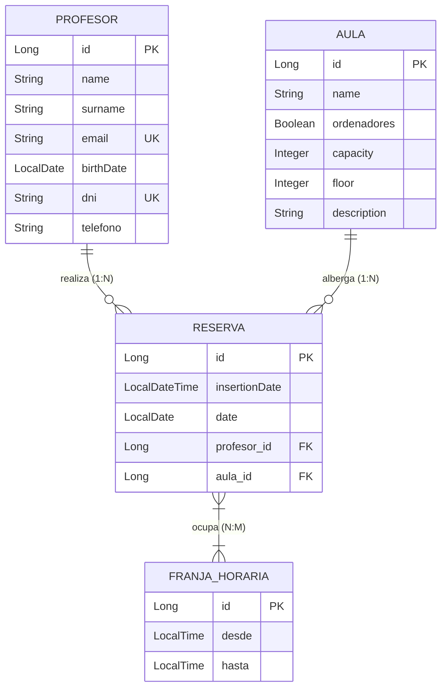

# Sistema de Gestión de Reservas de Aulas

[](https://www.oracle.com/java/)
[](https://spring.io/projects/spring-boot)
[](https://mariadb.org/)
[](https://projectlombok.org/)

Proyecto desarrollado para el módulo de **Acceso a Datos** de 2.º curso de **Desarrollo de Aplicaciones Multiplataforma (DAM)**.

---

## 📌 1. Descripción del Proyecto

API RESTful orientada a gestionar la asignación, disponibilidad y reserva de espacios en un centro educativo.

El sistema administra:
- **Profesores:** Docentes autorizados para realizar reservas.
- **Aulas:** Espacios físicos con información de capacidad, planta y dotación de equipos informáticos.
- **Franjas Horarias:** Intervalos de horas lectivas predefinidas (`desde` y `hasta`).
- **Reservas:** Asignaciones de un aula a un profesor en una fecha y franja horaria determinada, impidiendo solapamientos.

---

## 🏗️ 2. Modelo de Datos y Arquitectura



---

## ⚙️ 3. Puesta en Marcha Local

### Prerrequisitos
- **Java:** JDK 21 o 25 instalado.
- **Base de datos:** MariaDB o MySQL escuchando en `localhost:3306`.
- **Maven:** Incluido en el repositorio mediante `./mvnw`.

### Configuración de Base de Datos
En `src/main/resources/application.properties`:
```properties
spring.datasource.url=jdbc:mariadb://localhost:3306/app_db
spring.datasource.username=aitor
spring.datasource.password=aitor123
spring.datasource.driver-class-name=org.mariadb.jdbc.Driver

spring.jpa.hibernate.ddl-auto=update
spring.jpa.show-sql=true
spring.jpa.properties.hibernate.dialect=org.hibernate.dialect.MariaDBDialect
```

### Ejecución
```bash
./mvnw clean spring-boot:run
```
Servidor disponible en `http://localhost:8080`.

---

## 🔌 4. Catálogo de Endpoints REST

Todas las respuestas utilizan códigos de estado HTTP semánticos (`200 OK`, `201 Created`, `204 No Content`, `400 Bad Request`, `404 Not Found`).

### 1. Profesores (`/profesores`)
| Método | Endpoint | Descripción | Códigos HTTP |
|---|---|---|---|
| `GET` | `/profesores` | Lista todos los profesores | `200` |
| `GET` | `/profesores/{id}` | Obtiene profesor por ID | `200`, `404` |
| `POST` | `/profesores` | Crea un profesor | `201`, `400` |
| `PUT` | `/profesores/{id}` | Actualización completa de profesor | `200`, `404` |
| `PATCH` | `/profesores/{id}` | Actualización parcial de campos | `200`, `404` |
| `DELETE` | `/profesores/{id}` | Elimina profesor por ID | `204`, `404` |

### 2. Aulas (`/aulas`) - Filtros y Consultas Especiales
| Método | Endpoint | Descripción | Códigos HTTP |
|---|---|---|---|
| `GET` | `/aulas` | Lista aulas (admite filtros por query param) | `200` |
| `GET` | `/aulas/{id}` | Obtiene aula por ID | `200`, `404` |
| `POST` | `/aulas` | Crea un aula | `201`, `400` |
| `PUT` | `/aulas/{id}` | Actualización completa de aula | `200`, `404` |
| `PATCH` | `/aulas/{id}` | Actualización parcial de aula | `200`, `404` |
| `DELETE` | `/aulas/{id}` | Elimina aula por ID | `204`, `404` |

**Filtros mediante parámetros de consulta (`@RequestParam`):**
- `/aulas?ordenadores=true`: Filtra aulas que tienen ordenadores.
- `/aulas?capacidad=20` (o `?capacity=20`): Aulas con capacidad estrictamente superior al número indicado.
- `/aulas?ordenadores=true&capacidad=20`: Combinación simultánea de ambos filtros.

### 3. Franjas Horarias (`/franjas-horarias` / `/franjas`)
| Método | Endpoint | Descripción | Códigos HTTP |
|---|---|---|---|
| `GET` | `/franjas-horarias` | Lista franjas horarias | `200` |
| `GET` | `/franjas-horarias/{id}` | Obtiene franja por ID | `200`, `404` |
| `POST` | `/franjas-horarias` | Crea una franja horaria (`desde`, `hasta`) | `201`, `400` |
| `PUT` | `/franjas-horarias/{id}` | Modificación total | `200`, `404` |
| `PATCH` | `/franjas-horarias/{id}` | Modificación parcial | `200`, `404` |
| `DELETE` | `/franjas-horarias/{id}` | Elimina franja por ID | `204`, `404` |

### 4. Reservas (`/reservas`) - Reglas de Negocio
| Método | Endpoint | Descripción | Códigos HTTP |
|---|---|---|---|
| `GET` | `/reservas` | Lista reservas registradas | `200` |
| `GET` | `/reservas/{id}` | Obtiene reserva por ID | `200`, `404` |
| `POST` | `/reservas` | Inserta reserva validando disponibilidad y fecha | `201`, `400` |
| `PUT` | `/reservas/{id}` | Modificación total de reserva | `200`, `404` |
| `PATCH` | `/reservas/{id}` | Modificación parcial de reserva | `200`, `404` |
| `DELETE` | `/reservas/{id}` | Elimina reserva por ID | `204`, `404` |

---

## 🛡️ 5. Reglas de Validación de Reservas Implementadas

En cumplimiento del apartado 3 del enunciado, al crear una reserva (`POST /reservas`):
1. **Comprobación de solapamiento:** Mediante `ReservaService` y el método derivado `existsByAulaAndDateAndFranjasHorariasIn`, se verifica que ninguna de las franjas horarias seleccionadas esté ya reservada para la misma aula en la misma fecha.
2. **Fecha futura:** La fecha de reserva no puede ser anterior a la fecha actual (`!date.isBefore(LocalDate.now())`).
3. **Generación automática de auditoría:** El campo `insertionDate` se genera de forma transparente en la propia entidad `Reserva` mediante el hook `@PrePersist` (`LocalDateTime.now()`).

---

## 🤖 6. Desarrollo Asistido por Inteligencia Artificial (Apartado 5)

### Decisiones tomadas a partir de propuestas de la IA
- **Soporte dual de parámetros en Aulas:** Se adaptó `AulaController` para aceptar tanto `capacidad` (del enunciado) como `capacity` (del modelo), garantizando compatibilidad con pruebas de evaluación y clientes externos.
- **Arquitectura de Servicios:** Se desacopló la validación de negocio de reservas en `ReservaService` en lugar de sobrecargar el controlador.
- **Inmutabilidad de identificadores:** Se estableció la regla de no permitir modificación del `id` en `PUT` y `PATCH`, preservando la integridad de clave primaria de la base de datos.

### Problemas encontrados y errores corregidos
- **Condición invertida en controlador de reservas:** En una versión previa, la llamada `if (reservaService.valida(reserva))` rechazaba peticiones válidas. Se corrigió a `if (!reservaService.valida(reserva))`.
- **Comprobación de ID nulo en repositorio:** La consulta inicial de solapamiento comprobaba `id == null`, lo que impedía detectar colisiones con reservas ya guardadas en la base de datos. Se simplificó a `existsByAulaAndDateAndFranjasHorariasIn(Aula, LocalDate, Collection<FranjaHoraria>)`.
- **Ciclo de vida JPA en `Reserva`:** Se movió la inicialización de `insertionDate` del controlador al método `@PrePersist` de la entidad para dar cumplimiento literal al requisito de completarse en la propia entidad.

### Prompts de ejemplo utilizados
- *"Analiza el proyecto y la clase Aula con los cambios sin commitear todavía. Lo he intentado hacer sin IA y no sé si es correcto la documentación con los endpoints ni el método de findAll con las consultas puestas. ¿Puedes verificar si es correcto o explicarme si es que lo he hecho mal y arreglarlo?"*
- *"Quiero que analices el estado final del proyecto, me comentes si falta algo por aplicar del enunciado y que si todo es correcto, documentes en el README la información correcta y legible por humanos para este proyecto."*

---

## 📋 7. Estado del Proyecto y Requisitos Pendientes

- [x] **Especificación 1:** Entidades JPA, repositorios, controladores CRUD y `@PrePersist` en `Reserva`.
- [x] **Especificación 2:** Filtros de aulas por `ordenadores` y `capacidad` (`@RequestParam`).
- [x] **Especificación 3:** Validaciones de franjas horarias libres y fechas no pasadas en reservas.
- [ ] **Especificación 4 (Pendiente):** Creación del frontend en la carpeta `/frontend` con HTML, CSS y JavaScript vanilla.
- [x] **Especificación 5:** Documentación en `AGENTS.md`, `README.md` y bitácora en `DOC.md`.
- [ ] **Entrega:** Grabación del vídeo explicativo (5-10 minutos) mostrando Postman y frontend.
